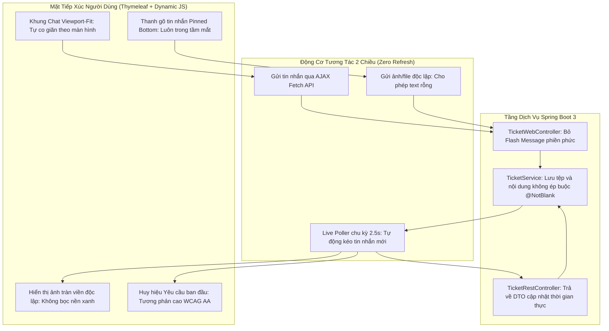

# 🚀 CHIẾN DỊCH TIẾN ĐỘ 10: HOÀN THIỆN TOÀN DIỆN SẢN PHẨM & CẢI TỔ ĐỘT PHÁ TRẢI NGHIỆM CHAT TƯ VẤN (QAUTE PORTAL)

> **Mục tiêu:** Thực hiện cuộc tổng kiểm toán (Product Audit) toàn diện mọi chức năng của hệ thống QAUTE Portal trước thềm bảo vệ; đồng thời giải quyết triệt để 7 vấn đề then chốt về trải nghiệm người dùng (UX/UI), luồng trao đổi trực tuyến (Real-time Consultation Chat), và xử lý tệp tin đa phương tiện giữa Sinh viên và Tư vấn viên tại `/tickets/detail/{id}`.  
> **Thời gian khởi tạo:** 02/10/2026.  
> **Tài liệu quy chiếu:** `docs/brief.md` > `docs/team/engineering-rules.md` > `AGENTS.md` > `.agents/skills/academic-ui-ux/SKILL.md`.

---

## 📊 1. TỔNG KIỂM TOÁN TÍNH HOÀN THIỆN CÁC CHỨC NĂNG HỆ THỐNG (PRODUCT AUDIT MATRIX)

*(Khảo sát chi tiết phân hệ cốt lõi, không tính phần Chatbox AI RAG đã hoàn thiện ở Tiến độ 9)*

| Phân hệ / Chức năng | Hiện trạng triển khai | Mức độ hoàn thiện | Đánh giá & Việc cần hoàn thiện trước ngày nghiệm thu |
| :--- | :--- | :---: | :--- |
| **1. Xác thực & Người dùng (Auth & RBAC)** | • Đăng nhập MSSV/Email + Password.<br>• Đăng ký sinh viên gửi OTP kích hoạt qua Email.<br>• Quên mật khẩu & cấp lại qua OTP.<br>• Phân quyền 4 vai trò: `STUDENT`, `STAFF`, `ADMIN`, `GUEST`.<br>• Trang cá nhân Profile & đổi mật khẩu. | **95% (Hoàn thiện cao)** | Đã hoạt động ổn định. Cần rà soát validation độ dài mật khẩu và chống CSRF form. |
| **2. Tiếp nhận Ticket Học vụ (Ticket Intake)** | • Sinh viên tạo Ticket có đính kèm file (tối đa 5 file, giới hạn dung lượng).<br>• Khách vãng lai tạo Ticket không cần login, cấp `guestToken`.<br>• Tính toán thời hạn SLA tự động theo mức độ ưu tiên.<br>• Phân loại theo đúng Khoa/Phòng ban trực thuộc. | **92% (Hoàn thiện cao)** | Cần tinh chỉnh bộ chọn file đính kèm trực quan và hỗ trợ kéo thả (drag-and-drop) mượt hơn. |
| **3. Tra cứu & Theo dõi Ticket (Tracking & CSAT)** | • Danh sách "Ticket Của Tôi" (`/tickets/my-tickets`) lọc trạng thái, phân trang.<br>• Tra cứu bằng mã khách (`/tickets/guest-track`).<br>• Đánh giá chất lượng CSAT 1-5 sao khi hoàn tất. | **90% (Hoàn thiện)** | Khách và SV đều đánh giá sao mượt mà bằng AJAX. Cần kiểm tra hiển thị khi ticket đã đóng. |
| **4. Bảng Tin Chính Thức & Diễn Đàn (Feed & Forum)** | • Bảng tin công văn (`/feed`).<br>• Diễn đàn sinh viên (`/feed/forum`) hỗ trợ thảo luận, hỏi đáp.<br>• Tương tác Like/Unlike không reload trang.<br>• Bình luận bằng AJAX.<br>• Video Hybrid (nhúng YouTube/Drive) & Đa tệp.<br>• Hàng đợi kiểm duyệt bài viết (`/moderation/posts`). | **90% (Hoàn thiện)** | Hoạt động trơn tru. Cần kiểm tra phân trang bình luận khi bài viết có trên 50 comment. |
| **5. Tra cứu FAQ Học Vụ (Knowledge Base)** | • Trang tra cứu FAQ (`/faq`) với thanh tìm kiếm trực tiếp.<br>• Phân loại theo Danh mục và accordion chi tiết.<br>• Cơ chế Human-in-the-loop: Nạp vé đã giải đáp thành công vào Kho FAQ AI. | **95% (Hoàn thiện cao)** | Giao diện đã chuẩn mực theo nhận diện HCMUTE. |
| **6. Dashboard Cán bộ & Quản trị (Staff/Admin Portal)** | • Dashboard Cán bộ (`/staff/tickets`) thống kê theo Khoa.<br>• Nhận vé (Claim Ticket) chống Race Condition bằng Atomic Query.<br>• Dashboard Quản trị toàn trường (`/admin/dashboard`).<br>• Quản lý người dùng (`/admin/users`) khóa/mở bằng AJAX + Toast.<br>• Quản lý danh mục Khoa/Phòng ban (`/admin/departments`). | **92% (Hoàn thiện)** | Cần kiểm tra export báo cáo thống kê SLA ra Excel/PDF nếu có yêu cầu. |
| **7. Cửa sổ Trao đổi Tư vấn Trực Tuyến (`/tickets/detail/{id}`)** | • Lịch sử trao đổi 2 chiều Cán bộ - Sinh viên.<br>• Danh thiếp Cán bộ phụ trách (Card + Modal profile).<br>• Sidebar quản lý media & file đã chia sẻ.<br>• Xem nhanh đa định dạng (PDF, Word, Excel, Ảnh, ZIP, Code). | **⚠️ 70% (CẦN CẢI TỔ GẤP)** | **Trọng tâm Sprint 10:** Phát hiện 7 vấn đề ảnh hưởng trực tiếp đến trải nghiệm thực tế (nền trắng chữ trắng, thiếu real-time, ảnh bị bọc nền xanh, bắt buộc nhập text khi gửi file, khung gõ tin nhắn bị chìm sâu...). |

---

## 🔍 2. MỔ XẺ 7 VẤN ĐỀ TRẢI NGHIỆM CHAT TƯ VẤN & NGUYÊN NHÂN GỐC RỄ

Qua ảnh chụp màn hình kiểm thử thực tế và phản ánh từ người dùng:

### ❌ Vấn đề 1: Huy hiệu tin nhắn hiển thị chữ trắng trên nền trắng (White on White)
- **Hiện tượng:** Tại bong bóng "Yêu cầu ban đầu" của sinh viên, huy hiệu hiển thị một khối màu trắng tinh, chữ bên trong cũng là màu trắng khiến người dùng không đọc được nội dung gì (phải bôi đen chuột mới thấy).
- **Nguyên nhân kỹ thuật:** Class `.bg-white` trong Bootstrap thiết lập `background-color: #fff !important;` ghi đè lên opacity của `.bg-opacity-20`, trong khi class `.text-white` áp dụng màu chữ `#ffffff`. Kết quả: nền trắng kết hợp chữ trắng.
- **Giải pháp:** Xóa bỏ kết hợp class lỗi. Thay thế bằng các class CSS chuyên biệt (`.chat-badge-req-me` và `.chat-badge-req-other`) với độ tương phản đạt chuẩn WCAG AA: chữ trắng trên nền xanh kính mờ (`rgba(255,255,255,0.22)`) hoặc chữ xanh đậm trên nền lam phấn (`#e0f2fe`).

### ❌ Vấn đề 2: Đoạn chat không chạy Real-time (phải Reload trang mới thấy phản hồi)
- **Hiện tượng:** Khi một bên gửi tin nhắn, bên đối diện không nhận được tin nhắn mới nếu không bấm F5 hoặc reload trang.
- **Nguyên nhân kỹ thuật:** Trang `detail.html` chỉ render dữ liệu tĩnh một lần từ Thymeleaf (`${ticket.histories}`). Thao tác gửi tin dùng Form POST truyền thống (`chatForm.submit()`) gây reload toàn bộ trang. Hệ thống chưa có cơ chế Webhook / Polling lắng nghe tin nhắn mới ở background.
- **Giải pháp:** 
  1. Chuyển form gửi phản hồi sang cơ chế **AJAX Fetch API**: người gửi tin nhắn sẽ thấy tin nhắn của mình xuất hiện tức thì trong chat stream (Zero Full-Page Refresh).
  2. Bổ sung cơ chế **Live Polling thông minh (Smart Polling)** với chu kỳ 2.5 - 3 giây gọi API `GET /api/v1/tickets/{ticketId}`: tự động phát hiện tin nhắn mới theo `history.id` và chèn mượt mà vào khung chat, đồng thời tự động cập nhật danh thiếp cán bộ nếu có sự kiện tiếp nhận vé.

### ❌ Vấn đề 3 & 4: Ảnh trong chat bị bọc nền xanh lè xấu xí; Yêu cầu hiển thị ảnh trọn vẹn và không bắt buộc nhập text khi gửi ảnh/tệp
- **Hiện tượng 1:** Ảnh gửi từ sinh viên bị bao bọc trong bong bóng chat màu xanh đậm (`.chat-bubble-me`) khiến bố cục thô kệch, màu nền xanh lấn át vẻ tự nhiên của bức ảnh.
- **Hiện tượng 2:** Khi người dùng chỉ muốn gửi ảnh hoặc tệp tài liệu, hệ thống ép buộc phải nhập nội dung chữ vào ô chat thì mới cho gửi (`Nội dung phản hồi không được để trống`).
- **Nguyên nhân kỹ thuật:**
  - Cấu trúc HTML gom chung cả text và attachments vào trong cùng một thẻ `div.chat-bubble-me`.
  - Thẻ `<textarea id="replyContent" ... required>` có thuộc tính HTML5 `required`.
  - Tầng DTO Backend `TicketReplyRequest.java` gắn nhãn `@NotBlank(message = "Nội dung phản hồi không được để trống")`.
- **Giải pháp:**
  1. Tách biệt cấu trúc hiển thị: Nếu tin nhắn chỉ có ảnh/tệp, khung bao bọc chuyển thành trong suốt (`background: transparent; border: none; box-shadow: none; padding: 0`). Ảnh hiển thị độc lập, viền bo mềm `12px`, bóng đổ nhẹ, kích thước lớn rõ nét, bấm vào phóng to trực tiếp.
  2. Bỏ thuộc tính `required` ở thẻ `<textarea>`.
  3. Xóa bỏ `@NotBlank` ở DTO `TicketReplyRequest.java` và cho phép `content` để trống khi có danh sách `files` đính kèm.

### ❌ Vấn đề 5: Tối ưu chọn file nhanh từ thư mục máy tính `D:\Picture\tailieumau`
- **Hiện tượng:** Người dùng thường xuyên kiểm thử hoặc gửi các tài liệu mẫu nằm trong thư mục `D:\Picture\tailieumau` trên máy tính, nhưng mỗi lần bấm tải file đều phải duyệt qua nhiều cấp thư mục của Windows File Explorer.
- **Nguyên nhân kỹ thuật:** Theo chuẩn bảo mật trình duyệt web (Web Security Sandbox), mã nguồn JavaScript không thể tự ý ép File Dialog của hệ điều hành nhảy vào một đường dẫn tuyệt đối trên ổ cứng. Tuy nhiên, trình duyệt luôn ghi nhớ thư mục vừa chọn gần nhất của trang web (`Recent Folder Persistence`).
- **Giải pháp kép:**
  1. Hướng dẫn người dùng thao tác chọn thư mục `D:\Picture\tailieumau` 1 lần đầu tiên để trình duyệt tự động ghim làm mặc định cho các lần mở sau.
  2. Trang bị ngay trên thanh công cụ chat nút trợ năng nhanh: **"📂 Mẫu: tailieumau"** và popover hướng dẫn gợi ý, giúp người dùng nhận diện và thao tác siêu tốc.

### ❌ Vấn đề 6: Bỏ dòng chữ "Phản hồi đã được ghi nhận thành công!" gây phiền toái
- **Hiện tượng:** Mỗi lần gửi một tin nhắn trao đổi, hệ thống đều in ra một thông báo banner flash màu xanh lá `"Phản hồi đã được ghi nhận thành công!"`, làm ngắt quãng trải nghiệm hội thoại.
- **Nguyên nhân kỹ thuật:** Phương thức `handleReplyTicket()` trong `TicketWebController.java` luôn gọi `redirectAttributes.addFlashAttribute("successMessage", "Phản hồi đã được ghi nhận thành công!");`.
- **Giải pháp:** 
  - Xóa bỏ hoàn toàn flash attribute này trong luồng trao đổi tin nhắn thường.
  - Giữ lại thông báo xác nhận thành công duy nhất cho hành động Cán bộ tiếp nhận xử lý vé (`"Bạn đã tiếp nhận xử lý yêu cầu #TK-XXXX"`) đúng như yêu cầu của người dùng.

### ❌ Vấn đề 7: Khung nhập tin nhắn nằm quá sâu bên dưới, gây khó khăn cho trải nghiệm
- **Hiện tượng:** Cửa sổ chat có chiều cao tĩnh lớn cộng thêm layout trang khiến khung nhập tin nhắn bị đẩy tụt xuống dưới màn hình. Người dùng liên tục phải cuộn chuột lên xuống để vừa đọc tin nhắn vừa gõ phản hồi.
- **Nguyên nhân kỹ thuật:** Khung `.chat-stream` đặt chiều cao cố định `height: 580px`, không sử dụng bố cục cố định khung nhìn (Viewport Docked Layout).
- **Giải pháp:** Tái cấu trúc khung chat theo mô hình **Messenger Viewport-Fit**:
  ```css
  .chat-card-container {
      height: calc(100vh - 130px);
      display: flex;
      flex-direction: column;
  }
  .chat-stream {
      flex: 1 1 auto;
      overflow-y: auto;
  }
  .chat-input-dock {
      flex-shrink: 0;
      position: sticky;
      bottom: 0;
      background: #ffffff;
      z-index: 10;
  }
  ```
  Thanh gõ tin nhắn luôn luôn nằm cố định ở chân màn hình, khung tin nhắn tự cuộn mượt mà bên trong, không bao giờ phải cuộn trang web!

---

## 🏛️ 3. KIẾN TRÚC MỤC TIÊU & THIẾT KẾ CẢI TIẾN



---

## 📋 4. ĐẶC TẢ NGHIỆP VỤ & ACCEPTANCE CRITERIA (GHERKIN)

### US-CHAT-01: Gửi ảnh và tệp đính kèm không cần gõ chữ
```gherkin
Scenario: Sinh viên chỉ gửi ảnh minh chứng lỗi học vụ mà không nhập nội dung chữ
  Given Sinh viên đang mở trang chi tiết yêu cầu "#TK-20261002-XXXX"
  When Sinh viên bấm chọn 1 bức ảnh chụp màn hình từ nút icon Ảnh
  And Ô nhập văn bản để trống hoàn toàn
  And Sinh viên bấm nút Gửi hoặc nhấn phím Enter
  Then Hệ thống không hiển thị thông báo lỗi yêu cầu nhập chữ
  And Tin nhắn được gửi thành công lên máy chủ
  And Trên màn hình chat, bức ảnh hiển thị độc lập, rõ ràng, không bị đóng khung trong bong bóng màu xanh lè.
```

### US-CHAT-02: Nhận tin nhắn mới tức thời không cần tải lại trang (Real-time Live Sync)
```gherkin
Scenario: Cán bộ phản hồi trong khi Sinh viên đang xem trang chi tiết
  Given Sinh viên đang dừng màn hình tại trang chi tiết Ticket
  When Cán bộ tư vấn gửi câu trả lời "Thầy đã kiểm tra học bạ của em..."
  Then Trong vòng 3 giây, khung chat của Sinh viên tự động xuất hiện tin nhắn mới của Cán bộ
  And Màn hình tự động cuộn nhẹ xuống cuối cùng
  And Trang web không bị nháy trắng hay reload toàn trang.
```

### US-CHAT-03: Khung nhập tin nhắn luôn ghim chân màn hình (Sticky Dock)
```gherkin
Scenario: Xem lịch sử tin nhắn dài mà không mất thanh gõ
  Given Cuộc trò chuyện có hơn 20 tin nhắn trao đổi
  When Người dùng cuộn xem lại các tin nhắn cũ phía trên
  Then Khung nhập tin nhắn vẫn giữ nguyên vị trí cố định dưới đáy màn hình
  And Người dùng có thể click gõ ngay lập tức mà không phải cuộn chuột xuống đáy trang.
```

---

## 🛠️ 5. KẾ HOẠCH HÀNH ĐỘNG CHI TIẾT (ACTION PLAN)

- [x] **Bước 1:** Cập nhật DTO `TicketReplyRequest.java` (gỡ bỏ `@NotBlank` trên trường `content`) và điều chỉnh `TicketWebController.java` (cho phép `content` rỗng khi có file, xóa bỏ flash attribute phiền phức).
- [x] **Bước 2:** Cập nhật `TicketService.java` xử lý linh hoạt phản hồi dạng tệp đính kèm thuần túy.
- [x] **Bước 3:** Tái thiết kế CSS trong `detail.html`:
  - Khắc phục triệt để lỗi màu chữ trắng trên nền trắng của các loại badge.
  - Phá vỡ background màu xanh bọc quanh hình ảnh; thiết kế thẻ ảnh độc lập thanh lịch.
  - Bố cục Viewport Docked Chat (chiều cao linh hoạt, thanh gõ tin nhắn ghim cố định).
- [x] **Bước 4:** Cải tiến JavaScript trong `detail.html`:
  - Hỗ trợ gửi tin nhắn qua AJAX không reload trang.
  - Thêm Smart Poller định kỳ 2.5s cập nhật tin nhắn mới tự động.
- [x] **Bước 5:** Biên dịch kiểm tra (`mvn test-compile`) và nghiệm thu các tiêu chí giao diện.

---

## 🚀 6. ĐỢT NÂNG CẤP BỔ SUNG: 4 VẤN ĐỀ TRỌNG TÂM (VD1 - VD4)

### ❌ Vấn đề 1: Thiếu bước hoàn tất giải quyết (RESOLVED) và đóng ticket (CLOSED) ở Cán bộ & Quản trị
- **Hiện tượng:** Cán bộ và Admin khi xem trang chi tiết vé tư vấn không có nút bấm trực tiếp để đánh dấu đã xử lý xong hoặc đóng vé. Tại Bàn Xử Lý Vé cũng thiếu các thao tác chuyển trạng thái dứt điểm.
- **Giải pháp:**
  1. Trang bị thẻ **"Tác Vụ Cán Bộ & Quản Trị"** ở sidebar phải của `detail.html` dành riêng cho vai trò `STAFF` và `ADMIN`:
     - **Nút "Hoàn Tất Giải Quyết (RESOLVED)":** Mở modal `#resolveTicketModal` cho phép nhập giải pháp chính thức và chuyển vé sang trạng thái `RESOLVED`.
     - **Nút "Đóng Ticket Trực Tiếp (CLOSED)":** Cho phép cán bộ/admin đóng vé trực tiếp với hộp thoại xác nhận an toàn.
  2. Bổ sung các hành động đóng/giải quyết nhanh trong dropdown menu tại bảng danh sách vé của Cán bộ (`staff-dashboard.html`).

---

### ❌ Vấn đề 2: Loại bỏ thư mục mẫu `D:\Picture\tailieumau` và thông báo copy clipboard phiền toái
- **Hiện tượng:** Dòng chữ `Thư mục mẫu: D:\Picture\tailieumau` và nút bấm sao chép kèm thông báo toast gây rối mắt và không cần thiết trong luồng làm việc thực tế.
- **Giải pháp:** 
  - Gỡ bỏ hoàn toàn nút `#btnQuickSampleFolder` và text `D:\Picture\tailieumau` khỏi thanh dock công cụ chat.
  - Xóa bỏ event listener sao chép đường dẫn và thông báo toast ở góc phải màn hình, trả lại không gian tối giản, tinh gọn cho giao diện chat.

---

### ❌ Vấn đề 3: Bổ sung tính năng xem nhanh trực tiếp (Quick Preview) cho các tệp `.md`, `.txt`, `.json`
- **Hiện tượng:** Trước đây Quick Preview chỉ tập trung vào `.pdf`, `.docx`, `.xlsx` và ảnh. Các tệp ghi chú Markdown (`.md`), tệp cấu hình/dữ liệu (`.json`), và văn bản thô (`.txt`, `.log`) bị thiếu hoặc hiển thị thô sơ.
- **Giải pháp:**
  1. Tích hợp thư viện `marked.js` (`https://cdn.jsdelivr.net/npm/marked@12.0.0/marked.min.js`) để biên dịch Markdown thành HTML chuẩn học thuật ngay trong modal `#quickPreviewModal` (`#previewMarkdownContainer`).
  2. Bổ sung viewer văn bản/code (`#previewCodeContainer`) tự động định dạng `JSON.stringify(parsed, null, 2)` đẹp mắt cho `.json` và hiển thị nguyên vẹn kèm thanh cuộn cho `.txt`, `.log`.
  3. Bổ sung icon chuẩn Bootstrap Icons (`bi-filetype-md`, `bi-filetype-json`, `bi-filetype-txt`) và nút Xem nhanh cho:
     - Khối đính kèm yêu cầu mở đầu (initial attachments).
     - Khối đính kèm trong tin nhắn hội thoại (history attachments).
     - Danh sách tệp đã chia sẻ ở sidebar phải.
     - Chip xem trước tệp trước khi gửi (`#fileSelectionPreview`).
     - Hàm render động JavaScript qua AJAX (`renderDocCard`).
  4. Cập nhật `accept` của thẻ `<input type="file" id="chatFileInput">` mở rộng cho phép chọn file `.md`.

---

### ❌ Vấn đề 4: Chủ động nhận biết tin nhắn mới từ Sinh viên - Badge đếm số tại Bàn Cán Bộ & Bàn Xử Lý Ticket
- **Hiện tượng:** Cán bộ không thể chủ động biết sinh viên đã nhắn tin phản hồi hay chưa nếu không trực tiếp bấm vào từng ticket. Dẫn đến tình trạng trễ nải trong khâu phản hồi học vụ.
- **Giải pháp toàn diện:**
  1. **Tầng Entity & Database:**
     - Bổ sung trường `hasStudentReply` (Boolean, mặc định `false`) vào `Ticket.java`.
     - Bổ sung `hasStudentReply` vào `TicketSummaryDto.java` và đồng bộ 6 câu JPQL Constructor Query trong `TicketRepository.java`.
  2. **Tầng Nghiệp vụ (Service & Controller):**
     - Khi sinh viên/khách gửi phản hồi (`TicketService.replyTicket`): tự động bật `ticket.setHasStudentReply(true)`. Nếu ticket đang ở trạng thái `WAITING_STUDENT`, tự động chuyển lại `IN_PROGRESS`.
     - Khi Cán bộ/Admin xem trang chi tiết vé (`ticketDetailPage`) hoặc gửi câu trả lời: hệ thống tự động gọi `ticketService.markStaffSeen(ticketId, staffId)` để xóa cờ báo tin mới (`hasStudentReply = false`).
     - Tạo REST API `GET /api/v1/staff/tickets/unread-summary` trả về tổng số ticket có tin nhắn mới từ sinh viên (phân quyền theo Khoa của cán bộ hoặc toàn trường với Admin).
  3. **Tầng Giao Diện (Navbar & Dashboard):**
     - **Navbar (`navbar.html`):** Bổ sung Badge đếm số màu đỏ nổi bật `navStaffUnreadBadge` tại menu **"Bàn Cán Bộ"** và `navStaffDropdownBadge` tại mục **"Bàn Xử Lý Ticket"**. Định kỳ 10 giây Poller tự động cập nhật số đếm thời gian thực.
     - **Thống kê Bàn Cán Bộ (`staff-dashboard.html`):** 
       - Thêm thẻ Counter Card thứ 5: **"Tin Mới Từ SV"** (màu đỏ Crimson rực rỡ, hiển thị số vé có tin nhắn mới chưa đọc).
       - Thêm bộ lọc nhanh **"Có tin mới từ SV"** (`status=NEW_REPLY`) trên thanh tìm kiếm.
       - Gắn nhãn badge đỏ nhấp nháy `Tin mới từ SV` ngay cạnh mã vé trong bảng danh sách giúp Cán bộ ưu tiên xử lý tức thì.

---

## 🎯 7. TỔNG KẾT FILE ĐÃ THAY ĐỔI

| STT | File | Mục đích thay đổi |
|---|---|---|
| 1 | `Ticket.java` | Bổ sung trường `hasStudentReply` |
| 2 | `TicketSummaryDto.java` | Bổ sung trường & constructor `hasStudentReply` |
| 3 | `TicketRepository.java` | Cập nhật JPQL constructor & đếm vé có tin nhắn mới |
| 4 | `TicketService.java` | Xử lý cờ `hasStudentReply`, hàm `markStaffSeen` |
| 5 | `TicketWebController.java` | Tự động đánh dấu cán bộ đã xem khi mở chi tiết vé |
| 6 | `StaffTicketWebController.java` | Bổ sung biến `countNewReplies` & lọc `NEW_REPLY` |
| 7 | `StaffTicketController.java` | Bổ sung REST API `/api/v1/staff/tickets/unread-summary` |
| 8 | `navbar.html` | Huy hiệu số đếm tin mới & Live Poller 10s |
| 9 | `staff-dashboard.html` | Thẻ thống kê Tin Mới Từ SV, bộ lọc & nhãn đỏ danh sách |
| 10 | `detail.html` | Box tác vụ Đóng/Giải quyết, gỡ thư mục mẫu, hỗ trợ xem nhanh `.md`, `.txt`, `.json` với `marked.js` |

